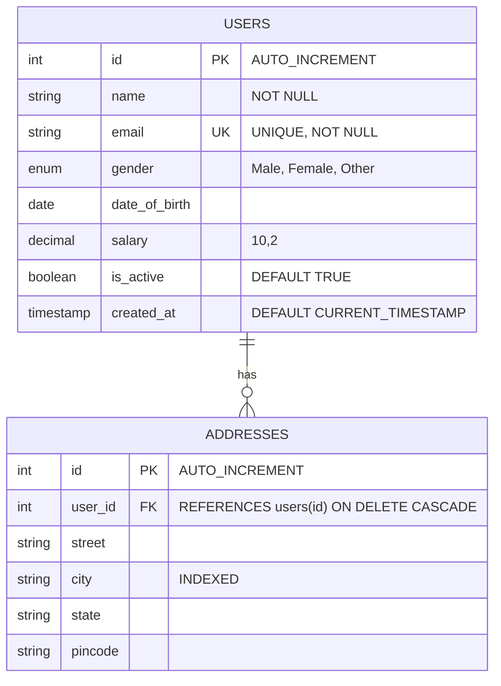

# 🗄️ SQL Begins: Comprehensive SQL Learning & Quick-Recall Hub

A clean, modular repository designed for learning, practicing, and quickly recalling foundational to intermediate SQL concepts.

---

## 🗺️ Repository Structure at a Glance

The codebase is organized chronologically by standard SQL categories so you can execute them step-by-step or jump straight to any topic for quick reference:

```text
SQL-begins/
├── 01_ddl_schema/              # Data Definition Language (Databases & Tables)
│   ├── 01_create_databases.sql
│   ├── 02_create_tables.sql
│   └── 03_alter_tables.sql
│
├── 02_constraints/             # Database Integrity & Business Rules
│   └── 01_constraints_overview.sql
│
├── 03_dml_seed_data/           # Sample Data (Users & Relational Addresses)
│   ├── 01_insert_users.sql
│   └── 02_insert_addresses.sql
│
├── 04_dql_queries/             # Data Query Language (SELECT, Filter, Sort)
│   ├── 01_basic_select.sql
│   └── 02_filtering_and_sorting.sql
│
├── 05_dml_crud_operations/     # Data Manipulation Language (UPDATE & DELETE)
│   ├── 01_update_records.sql
│   └── 02_delete_records.sql
│
├── 06_built_in_functions/      # Built-in SQL Functions (Aggregates & Strings)
│   ├── 01_aggregate_functions.sql
│   └── 02_scalar_string_functions.sql
│
└── 07_tcl_transactions/        # Transaction Control Language (ACID & Rollback)
    └── 01_transaction_control.sql
```

---

## ⚡ Quick-Recall SQL Cheatsheet

Use this section as a quick reference when you need to recall SQL syntax fast:

| Concept | Command / Syntax Example | File Reference |
| :--- | :--- | :--- |
| **Create DB** | `CREATE DATABASE IF NOT EXISTS startersql;` | [`01_ddl_schema/01_create_databases.sql`](01_ddl_schema/01_create_databases.sql) |
| **Create Table** | `CREATE TABLE users (id INT AUTO_INCREMENT PRIMARY KEY, name VARCHAR(100));` | [`01_ddl_schema/02_create_tables.sql`](01_ddl_schema/02_create_tables.sql) |
| **Alter Table** | `ALTER TABLE users ADD COLUMN is_active BOOLEAN DEFAULT TRUE;` | [`01_ddl_schema/03_alter_tables.sql`](01_ddl_schema/03_alter_tables.sql) |
| **Check Rule** | `ALTER TABLE users ADD CONSTRAINT chk CHECK (salary >= 0);` | [`02_constraints/01_constraints_overview.sql`](02_constraints/01_constraints_overview.sql) |
| **Foreign Key** | `FOREIGN KEY (user_id) REFERENCES users(id) ON DELETE CASCADE;` | [`02_constraints/01_constraints_overview.sql`](02_constraints/01_constraints_overview.sql) |
| **Insert** | `INSERT INTO users (name, email) VALUES ('Riya', 'riya@mail.com');` | [`03_dml_seed_data/01_insert_users.sql`](03_dml_seed_data/01_insert_users.sql) |
| **Select & Alias**| `SELECT name AS user_name, (salary * 12) AS annual FROM users;` | [`04_dql_queries/01_basic_select.sql`](04_dql_queries/01_basic_select.sql) |
| **Filter & Sort**| `SELECT * FROM users WHERE salary > 50000 ORDER BY salary DESC LIMIT 5;` | [`04_dql_queries/02_filtering_and_sorting.sql`](04_dql_queries/02_filtering_and_sorting.sql) |
| **Update** | `UPDATE users SET salary = salary + 5000 WHERE salary < 40000;` | [`05_dml_crud_operations/01_update_records.sql`](05_dml_crud_operations/01_update_records.sql) |
| **Delete** | `DELETE FROM users WHERE gender = 'Other';` | [`05_dml_crud_operations/02_delete_records.sql`](05_dml_crud_operations/02_delete_records.sql) |
| **Aggregates** | `COUNT(*)`, `SUM(salary)`, `AVG(salary)`, `MIN(salary)`, `MAX(salary)` | [`06_built_in_functions/01_aggregate_functions.sql`](06_built_in_functions/01_aggregate_functions.sql) |
| **Group By** | `SELECT gender, COUNT(*) FROM users GROUP BY gender HAVING COUNT(*) > 5;` | [`06_built_in_functions/01_aggregate_functions.sql`](06_built_in_functions/01_aggregate_functions.sql) |
| **String Funcs** | `LOWER(name)`, `UPPER(name)`, `CONCAT(first, '_', last)`, `LENGTH(name)` | [`06_built_in_functions/02_scalar_string_functions.sql`](06_built_in_functions/02_scalar_string_functions.sql) |
| **Transactions** | `START TRANSACTION;` &rarr; `UPDATE ...` &rarr; `ROLLBACK;` (or `COMMIT;`) | [`07_tcl_transactions/01_transaction_control.sql`](07_tcl_transactions/01_transaction_control.sql) |

---

## 📊 Database Schema Overview

### 1. `startersql` Database (Primary)



### 2. `Rohitsql` Database (Secondary Sandbox)
* **`usersDB`**: Lightweight isolated playground table for experimenting with basic types without impacting the primary database.

---

## 🚀 Execution Guide (Run in Terminal / MySQL Client)

Execute the scripts in order to build the database, seed mock records, and test queries:

```sql
-- Step 1: Initialize Database & Schema
SOURCE 01_ddl_schema/01_create_databases.sql;
SOURCE 01_ddl_schema/02_create_tables.sql;
SOURCE 01_ddl_schema/03_alter_tables.sql;

-- Step 2: Apply Business Integrity Rules & Constraints
SOURCE 02_constraints/01_constraints_overview.sql;

-- Step 3: Seed Realistic Data (30 Users & 25 Addresses)
SOURCE 03_dml_seed_data/01_insert_users.sql;
SOURCE 03_dml_seed_data/02_insert_addresses.sql;

-- Step 4: Run Queries & Practice Filtering
SOURCE 04_dql_queries/01_basic_select.sql;
SOURCE 04_dql_queries/02_filtering_and_sorting.sql;

-- Step 5: Test Updates and Cascade Deletes
SOURCE 05_dml_crud_operations/01_update_records.sql;
SOURCE 05_dml_crud_operations/02_delete_records.sql;

-- Step 6: Practice Built-in Functions (Aggregates & Strings)
SOURCE 06_built_in_functions/01_aggregate_functions.sql;
SOURCE 06_built_in_functions/02_scalar_string_functions.sql;

-- Step 7: Test Transaction Isolation (COMMIT & ROLLBACK)
SOURCE 07_tcl_transactions/01_transaction_control.sql;
```

---

## 💡 Important Rules to Remember

1. **Always Use `WHERE` on `DELETE` and `UPDATE`:** Unscoped `DELETE` or `UPDATE` statements will impact every row in the table.
2. **`DELETE` vs `TRUNCATE` vs `DROP`:**
   - `DELETE`: DML row-by-row operation; rollbackable inside a transaction.
   - `TRUNCATE`: DDL table wipe; resets auto-increment counter; cannot be rolled back in MySQL.
   - `DROP`: Destroys table definition, structure, indexes, and records completely.
3. **Foreign Keys with `ON DELETE CASCADE`:** Deleting a user automatically removes their corresponding address records, preserving relational integrity without orphan rows.
4. **Transactions for Safety:** Use `SET autocommit = 0;` or `START TRANSACTION;` to test risky batch operations before confirming with `COMMIT;` or aborting with `ROLLBACK;`.