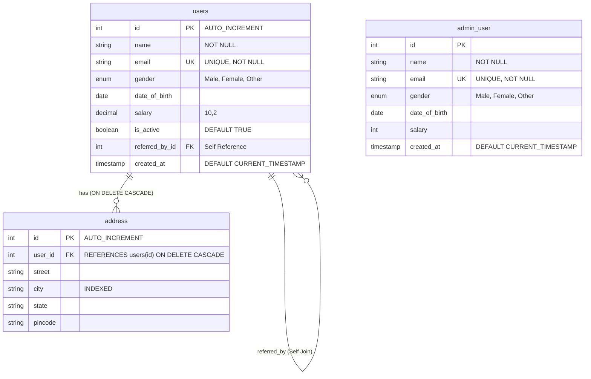

# 🗄️ SQL Begins: Comprehensive Learning & Quick-Recall Hub

A clean, modular repository designed for learning, practicing, and quickly recalling foundational to advanced SQL concepts without duplicate files or cluttered scripts.

---

## 🗺️ Repository Structure (Numbered Learning Roadmap)

The repository is organized sequentially so each concept has **one single canonical home**:

```text
SQL-begins/
├── 01_schema_ddl/                  # 1. Database & Table Definitions (DDL)
│   ├── 01_create_tables.sql        #    CREATE DATABASE, users, address, admin_user
│   └── 02_alter_tables.sql         #    ALTER TABLE (ADD, MODIFY, DROP columns & indexes)
│
├── 02_constraints/                 # 2. Database Integrity & Constraints
│   └── 01_table_constraints.sql   #    PRIMARY KEY, FOREIGN KEY CASCADE, UNIQUE, CHECK, DEFAULT
│
├── 03_seed_data/                   # 3. Seed Mock Data (DML)
│   ├── 01_insert_users.sql         #    30 realistic user records
│   ├── 02_insert_address.sql       #    Relational addresses mapped to user IDs
│   └── 03_insert_admin_users.sql   #    Admin accounts for joins and set operations
│
├── 04_queries_dql/                 # 4. Data Query Language (DQL)
│   ├── 01_select_basics.sql        #    SELECT, Column Aliases (AS), DISTINCT, LIMIT
│   └── 02_filtering_and_sorting.sql#    WHERE, AND/OR, BETWEEN, IN, LIKE, ORDER BY, OFFSET
│
├── 05_crud_dml/                    # 5. Data Manipulation Language (DML)
│   ├── 01_update_records.sql       #    Single and conditional bulk UPDATEs with math
│   └── 02_delete_records.sql       #    DELETE with WHERE, cascade observations, TRUNCATE vs DROP
│
├── 06_functions/                   # 6. Built-in SQL Functions
│   ├── 01_aggregate_functions.sql  #    COUNT, MIN, MAX, SUM, AVG, GROUP BY, HAVING
│   └── 02_string_scalar_functions.sql # LOWER, UPPER, CONCAT, LENGTH, SUBSTRING, DATES
│
├── 07_joins/                       # 7. Table Relationships & Joins
│   ├── 01_inner_and_left_joins.sql #    INNER JOIN, LEFT JOIN, finding missing records with NULL
│   └── 02_self_join.sql            #    Self Join (hierarchical referral & manager relationships)
│
├── 08_set_operations/              # 8. Set Operations
│   └── 01_union_and_union_all.sql  #    UNION (deduped) vs UNION ALL (with duplicates)
│
├── 09_transactions_tcl/            # 9. Transaction Control Language (TCL)
│   └── 01_autocommit_and_transactions.sql # SET autocommit, START TRANSACTION, COMMIT, ROLLBACK
│
└── 10_views/                       # 10. Database Views (Virtual Tables)
    └── 01_create_and_manage_views.sql     # CREATE VIEW, secure views, multi-table views, DROP VIEW
```

---

## ⚡ Quick-Recall SQL Cheatsheet

| Module | Core Concept | Quick Syntax / Example | Reference File |
| :--- | :--- | :--- | :--- |
| **01 DDL** | Create Table | `CREATE TABLE users (id INT AUTO_INCREMENT PRIMARY KEY, name VARCHAR(100));` | [`01_schema_ddl/01_create_tables.sql`](01_schema_ddl/01_create_tables.sql) |
| **01 DDL** | Alter Table | `ALTER TABLE users ADD COLUMN is_active BOOLEAN DEFAULT TRUE;` | [`01_schema_ddl/02_alter_tables.sql`](01_schema_ddl/02_alter_tables.sql) |
| **02 Constraints** | Check Rule | `ALTER TABLE users ADD CONSTRAINT chk_dob CHECK (date_of_birth >= '1990-01-01');` | [`02_constraints/01_table_constraints.sql`](02_constraints/01_table_constraints.sql) |
| **02 Constraints** | Foreign Key | `FOREIGN KEY (user_id) REFERENCES users(id) ON DELETE CASCADE;` | [`02_constraints/01_table_constraints.sql`](02_constraints/01_table_constraints.sql) |
| **03 Seed Data** | Insert Rows | `INSERT INTO users (name, email) VALUES ('Riya', 'riya@mail.com');` | [`03_seed_data/01_insert_users.sql`](03_seed_data/01_insert_users.sql) |
| **04 DQL** | Select & Alias | `SELECT name AS full_name, (salary * 12) AS annual FROM users;` | [`04_queries_dql/01_select_basics.sql`](04_queries_dql/01_select_basics.sql) |
| **04 DQL** | Filter & Sort | `SELECT * FROM users WHERE salary > 50000 ORDER BY salary DESC LIMIT 5;` | [`04_queries_dql/02_filtering_and_sorting.sql`](04_queries_dql/02_filtering_and_sorting.sql) |
| **05 CRUD** | Update | `UPDATE users SET salary = salary + 10000 WHERE salary < 60000;` | [`05_crud_dml/01_update_records.sql`](05_crud_dml/01_update_records.sql) |
| **05 CRUD** | Delete | `DELETE FROM users WHERE gender = 'Other';` | [`05_crud_dml/02_delete_records.sql`](05_crud_dml/02_delete_records.sql) |
| **06 Functions** | Aggregates | `SELECT gender, COUNT(*), ROUND(AVG(salary), 2) FROM users GROUP BY gender;` | [`06_functions/01_aggregate_functions.sql`](06_functions/01_aggregate_functions.sql) |
| **06 Functions** | Strings | `SELECT CONCAT(LOWER(name), '_dev'), LENGTH(name) FROM users;` | [`06_functions/02_string_scalar_functions.sql`](06_functions/02_string_scalar_functions.sql) |
| **07 Joins** | INNER JOIN | `SELECT u.name, a.city FROM users u INNER JOIN address a ON u.id = a.user_id;` | [`07_joins/01_inner_and_left_joins.sql`](07_joins/01_inner_and_left_joins.sql) |
| **07 Joins** | LEFT JOIN | `SELECT u.name, a.city FROM users u LEFT JOIN address a ON u.id = a.user_id;` | [`07_joins/01_inner_and_left_joins.sql`](07_joins/01_inner_and_left_joins.sql) |
| **07 Joins** | Self Join | `SELECT a.name, b.name AS referrer FROM users a INNER JOIN users b ON a.referred_by_id = b.id;` | [`07_joins/02_self_join.sql`](07_joins/02_self_join.sql) |
| **08 Set Ops** | UNION | `SELECT name, email FROM users UNION SELECT name, email FROM admin_user;` | [`08_set_operations/01_union_and_union_all.sql`](08_set_operations/01_union_and_union_all.sql) |
| **08 Set Ops** | UNION ALL | `SELECT name, email FROM users UNION ALL SELECT name, email FROM admin_user;` | [`08_set_operations/01_union_and_union_all.sql`](08_set_operations/01_union_and_union_all.sql) |
| **09 TCL** | Rollback | `SET autocommit = 0;` &rarr; `DELETE FROM users WHERE id=1;` &rarr; `ROLLBACK;` | [`09_transactions_tcl/01_autocommit_and_transactions.sql`](09_transactions_tcl/01_autocommit_and_transactions.sql) |
| **09 TCL** | Commit | `START TRANSACTION;` &rarr; `UPDATE ...;` &rarr; `COMMIT;` &rarr; `SET autocommit = 1;` | [`09_transactions_tcl/01_autocommit_and_transactions.sql`](09_transactions_tcl/01_autocommit_and_transactions.sql) |
| **10 Views** | View Creation | `CREATE OR REPLACE VIEW rich_users AS SELECT * FROM users WHERE salary > 70000;` | [`10_views/01_create_and_manage_views.sql`](10_views/01_create_and_manage_views.sql) |

---

## 📊 Relational Database Architecture



---

## 🚀 Step-by-Step Execution Guide

Run the following scripts in order to set up databases, tables, constraints, seed records, and practice all query types:

```sql
-- Step 1: DDL & Tables
SOURCE 01_schema_ddl/01_create_tables.sql;
SOURCE 01_schema_ddl/02_alter_tables.sql;

-- Step 2: Constraints & Integrity
SOURCE 02_constraints/01_table_constraints.sql;

-- Step 3: Seed Data
SOURCE 03_seed_data/01_insert_users.sql;
SOURCE 03_seed_data/02_insert_address.sql;
SOURCE 03_seed_data/03_insert_admin_users.sql;

-- Step 4: Queries & Filters
SOURCE 04_queries_dql/01_select_basics.sql;
SOURCE 04_queries_dql/02_filtering_and_sorting.sql;

-- Step 5: Updates & Deletes
SOURCE 05_crud_dml/01_update_records.sql;
SOURCE 05_crud_dml/02_delete_records.sql;

-- Step 6: Built-in Functions
SOURCE 06_functions/01_aggregate_functions.sql;
SOURCE 06_functions/02_string_scalar_functions.sql;

-- Step 7: Table Joins & Self Joins
SOURCE 07_joins/01_inner_and_left_joins.sql;
SOURCE 07_joins/02_self_join.sql;

-- Step 8: Set Operations
SOURCE 08_set_operations/01_union_and_union_all.sql;

-- Step 9: Transactions & Rollback
SOURCE 09_transactions_tcl/01_autocommit_and_transactions.sql;

-- Step 10: Database Views
SOURCE 10_views/01_create_and_manage_views.sql;
```

---

## 🧠 Key Rules to Recall (Interview & Daily Practice)

1. **Self Joins:**
   - Join a table to itself using two distinct aliases (`users a` and `users b`).
   - Essential for hierarchical data like employee-manager or user-referral systems.
2. **Database Views:**
   - Virtual tables generated dynamically from a query without duplicating stored records.
   - Great for data security (hiding salaries/PII) and simplifying complex joins.
3. **`UNION` vs `UNION ALL`:**
   - `UNION`: Automatically runs a distinct sort operation to remove duplicates across queries.
   - `UNION ALL`: Appends results immediately without deduplication (faster).
4. **`INNER JOIN` vs `LEFT JOIN`:**
   - `INNER JOIN`: Only outputs rows where the join condition matches in **both** tables.
   - `LEFT JOIN`: Outputs **all** rows from the left table, even if the right table has no match (fills with `NULL`).
5. **`DELETE` vs `TRUNCATE` vs `DROP`:**
   - `DELETE`: DML operation; removes row-by-row; can be rolled back inside a transaction.
   - `TRUNCATE`: DDL operation; resets the entire table and resets `AUTO_INCREMENT` back to 1.
   - `DROP`: DDL operation; deletes the table structure, constraints, and all data permanently.
6. **`ON DELETE CASCADE`:**
   - Guarantees referential integrity: deleting a row in the parent table (`users`) automatically cascades and deletes related rows in child tables (`address`), eliminating orphan records.